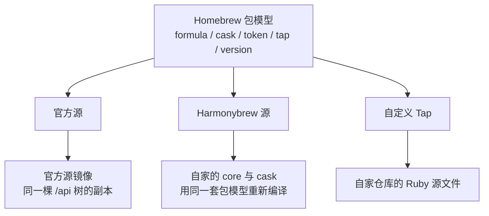
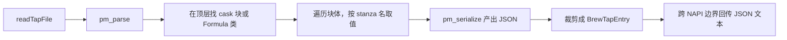

# 自定义 Tap · 设计

> 日期：2026-10-10。状态：待评审。评审通过后由 `writing-plans` 产出实施计划。
> 范围：新增独立 HAR 模块 `features/tapkit`（libgit2 与 prism 两个 C 库及其 NAPI 绑定）；
> `features/brewcommon` 增加 Tap 的注册表、同步与索引，并给详情取数增加一个入口；
> 新增页签模块 `features/brewtaps`（「我的 Taps」）；`features/pcui` 增加页签入口。
> 相关文档：[`brew-api-design.md`](../../brew-api-design.md) §7（现网数据源）、
> [`2026-09-23-brew-multi-source-design.md`](2026-09-23-brew-multi-source-design.md)（源注册表与按源缓存）、
> [`2026-10-04-brew-installed-packages-spec.md`](2026-10-04-brew-installed-packages-spec.md)（本机包的读取通道）。

---

## 1. 结论

1. **Tap 与三种源并列，独立成一个页签。** 侧边栏新增「我的 Taps」，里面列出用户添加过的 Tap；
   每个 Tap 的行尾两个按钮分别进入该 Tap 的 Formulae 与 Casks 二级页。Tap 不进源注册表、
   不进 Discover 的三张榜、不参与「使用中」这套单选语义。两块设计互相独立。

2. **Tap 由应用自己管理，不依赖设备上的 brew。** 添加一个 Tap 等于把它克隆到应用沙箱；
   读它的内容等于直接读克隆下来的 Ruby 源文件。因此 `pc_acl`（有本机包能力）与
   `pc_normal`（没有本机包能力）在 Tap 功能上行为完全一致：不需要 brew、不需要命令行、
   不需要 `CUSTOM_SANDBOX` 权限。

3. **只列应用自己添加的 Tap。** 设备上 `brew tap` 过的仓库（例如 `handwer/cask-store`）
   不出现在列表里。列表完全由应用维护，两种产品的列表形态一致。

4. **两个 C 依赖放在独立的 HAR 模块里。** 新增 `features/tapkit`，内含 libgit2（取仓库）
   与 prism（解析 Ruby）的源码与 NAPI 绑定；`features/pcnative`（命令执行通道）不动。

---

## 2. 四种东西的联系与区别

### 2.1 事实对照

| | 官方源 | 官方源镜像 | Harmonybrew 源 | 自定义 Tap |
|---|---|---|---|---|
| 提供方 | formulae.brew.sh | 任意第三方复刻站点 | harmonybrew.atomgit.com | 某个 Git 仓库的作者 |
| 存在形式 | 一个 HTTP 服务 | 同一个 HTTP 服务的副本 | 另一个 HTTP 服务 | 一个 Git 仓库 |
| 地址 | `https://formulae.brew.sh/api` | 与官方源同形状的 `/api` 树 | `https://harmonybrew.atomgit.com/api` | 没有地址，只有 clone URL |
| 内容范围 | 官方两个仓库 | 与官方源相同 | 自家的 `core` 与 `cask` | 这个仓库里的 `Formula/` 与 `Casks/` |
| 标识名 | `homebrew/core` / `homebrew/cask` | 同左 | `harmonybrew/core` / 空 | `user/repo` |
| 有机器可读索引吗 | 有（`formula.jws.json` 与 `cask.jws.json`） | 取决于镜像是否完整 | 有 formula，cask 为空 | 没有 |
| 有单条端点吗 | 有 | 通常有 | 没有 | 没有 |
| 有安装量统计吗 | 有（四个聚合端点） | 通常有 | 没有（用按日下载量合成） | 没有 |
| 应用怎么取它 | HTTP | HTTP | HTTP | 把 Git 仓库克隆到沙箱 |
| 用户怎么增删 | 不能 | 能 | 能 | 能 |
| 切换要重启吗 | 要 | 要 | 要 | 不要（它不改变任何取数地址） |
| 包名的写法 | `wget` | `wget` | `aamath` | `user/repo/token` |

本机实测的端点对照：

| 端点 | 官方源 | Harmonybrew 源 |
|---|---|---|
| `/api/formula.jws.json` | 34.5 MB，payload 是数组，`tap` 字段为 `homebrew/core` | 11.9 MB，`tap` 为 `harmonybrew/core` |
| `/api/cask.jws.json` | 有 | payload 恒为 `{}` |
| `/api/formula/<token>.json` | 有（比全量包多 `analytics` 与 `generated_date`） | 404 |
| `/api/analytics/…` | 有 | 404 |
| `/api/internal/packages.<tag>.jws.json` | 有（7 个 tag） | 有（`arm64_ohos`） |

自定义 Tap 一侧的实测：`brew tap-new` 的模板只创建 `Formula/`、`README.md` 与三个 GitHub Actions
工作流，既不创建也不发布 `api/` 目录；Homebrew 的 CI（`generate-formula-api.rb`、
`generate-internal-api.rb`）只为 `CoreTap` 与 `CoreCaskTap` 产出 JSON。
`ohosbrew/homebrew-tap`、`handwer/cask-store`、`heroku/homebrew-brew` 三个仓库都没有 `api/` 目录。

### 2.2 联系



三条联系：

1. **同一套包模型。** 四种东西给出的字段名与语义都来自 Homebrew 自己：`token`、`desc`、
   `versions.stable`、`artifacts`、`depends_on`、`deprecated`。一个 Tap 里的 cask 与官方源里的 cask
   在 `brew info --json=v2` 的输出里字段完全一致（本机实测 `handwer/cask-store/fzf`
   与官方 cask 的键集合相同）。

2. **同一种包名限定方式。** Tap 的包包名写成 `user/repo/token`，这正是 `brew install` 接受的写法，
   也是 `BrewCommandGenerator.qualifiedName(token, tap)` 已经支持的形式。

3. **镜像与源是复制关系，Tap 与源是并列关系。** 镜像必须提供与官方源相同的整棵 `/api`；
   Tap 与任何一个源都没有内容上的对应关系。

### 2.3 三条决定设计的区别

1. **Tap 没有机器可读索引。** 源的内容以 JSON 交付，Tap 的内容以 Ruby 源码交付。
   所以「读 Tap」这件事必须有一层源码解析，而源那条链路上完全没有这一步。

2. **Tap 不是取数地址。** 源回答「我从哪里下载 JSON」，切换它要重启；Tap 回答
   「这台机器上还有哪些包」，与当前用哪个源无关。把 Tap 放进源注册表会让「使用中」
   这个标记失去意义。

3. **Tap 的包没有全局热度。** 三张榜依赖全量安装量分布（分位数门槛与 family 去重），
   官方 analytics 端点只覆盖两个官方 tap，Tap 自身不提供任何统计端点。
   这是 Tap 不进 Discover 的原因。

### 2.4 Tap 不进 Discover 的理由

Discover 的三张榜口径是：`prior = (365d − 30d) / 除数`、`velocity = 30d / prior`、
趋势榜按 `log1p(velocity) × log1p(30d)` 排序，另有两个取自全量分布分位数的门槛。
这套算法的前提是手上有一份覆盖全部成员的安装量统计。Tap 的包在官方 analytics 里没有条目，
Tap 自身也不提供统计，能拿到的量级只有 `brew info` 输出里这台机器自己的安装记录。

要让 Tap 进榜只有两条路：给它一个与官方榜同口径的名次（没有输入，做不到），
或者为它单独建一个口径不同的榜（同一页上出现两种含义的数字，用户在榜卡上看不出差别）。
两条都不成立，因此 Tap 的内容用一个独立页签呈现。

---

## 3. 方案选择记录

### 3.1 Tap 的内容来源：解析 Ruby 源码

| 做法 | 结论 |
|---|---|
| **解析 Ruby 源码**（采用） | Tap 的内容就是 Ruby 源文件，这是它的唯一权威交付形式。用成熟的 C 解析库取 stanza，不自己写字符串匹配 |
| 只读 Tap 自带的 JSON 索引 | 不可用：仓库普遍没有 `api/` 目录（§2.1 的实测） |
| 只用文件名当 token | 信息量不足：没有 `desc` 就算不出分类，只能在整仓库解析失败时作为降级手段 |
| 依赖设备上的 `brew info --json` | 不可用：`pc_normal` 没有本机包能力，而本功能要上线到它上面 |
| 内嵌 Ruby 解释器 | 不做：体积与启动代价都远大于「只要语法树」这个需求 |

### 3.2 取仓库的通道：内置 libgit2

| 做法 | 结论 |
|---|---|
| **libgit2**（采用） | C 库，交叉编译进独立 HAR 模块。协议、浅克隆、增量更新与校验都由它负责 |
| 自写最小 git 客户端 | 否决：smart HTTP v2 的 pkt-line 协商、packfile（含 ofs/ref delta）与校验都要自己担保，出错表现为静默的数据损坏 |
| 只下归档压缩包 | 否决：实测 gitcode 与 atomgit 的归档端点返回网页而不是压缩包（状态码 206 但 `content-type: text/html`），只有 GitHub 系可用；而用户实际在用的 `handwer/cask-store` 托管在 gitcode 上 |
| 依赖设备上的 `git` | 否决：`pc_normal` 没有命令执行能力 |

### 3.3 列表的范围：只列应用自己添加的

设备上已有的 Tap 不出现。三条理由：

1. 列表的语义是「我在这个应用里加过什么」，由应用自己维护，用户可以预期它的内容；
2. 读设备上的 Tap 需要 `brew tap-info` 或 `brew info`，那是 `pc_acl` 独有的能力，
   会让两种产品的列表形态不一致，而这个功能要上线到 `pc_normal`；
3. 读设备上已有的 Tap 属于「本机包」那条链路，不是本轮需求。

### 3.4 与设备上 brew 的 tap trust 无关

brew 7.0 起，非官方 Tap 里的 formula、cask、command 必须先 `brew trust` 过才会被加载，
否则 install 会报 `Error: Refusing to load formula <user>/<tap>/<token> from untrusted tap <user>/<tap>.`。
这件事与本设计的 Tap 索引是**两条互不相干的链路**：

| | 本设计的 Tap | 设备上 brew 的 Tap |
|---|---|---|
| 内容来源 | 应用自己克隆到沙箱，直接读 Ruby 源文件 | brew 自己克隆在 `<prefix>/Homebrew/Library/Taps/` |
| 是否需要 trust | 不需要：不走 brew，也没有代码执行 | 需要，`trust.json` 里列过才加载 |
| `pc_normal` | 有 | 没有 |

因此「用户在这个应用里添加了一个 Tap」不等于「brew 信任这个 Tap」。详情页的「安装命令」卡片
给出的是可复制的命令行，用户拿去执行时，设备上的 brew 仍然按自己的 `trust.json` 判定。

实测（2026-11-21，brew 7.0.9_7）：trust 存在 `${HOMEBREW_USER_CONFIG_HOME}/trust.json`，
而 `HOMEBREW_USER_CONFIG_HOME` 由 `XDG_CONFIG_HOME`（`bin/brew:164-172`）推出，
所以应用与系统终端读的是两份不同的文件，在一边 trust 过不会影响另一边。
对自定义 remote 的 Tap，`trustedtaps` 里必须写 remote URL 而不是 `user/tap` 名字
（`tap.rb:941-958`）；`harmony/ohos` 的 remote 是
`https://gitcode.com/OpenHarmonyPCDeveloper/ohpcd-brew.git`，只写名字不生效。
细节与复现命令见 [`knowledge/2026-11-21-brew-tap-trust.md`](../../knowledge/2026-11-21-brew-tap-trust.md)。

本设计**不代管** trust：不写 `trust.json`、不注入 `HOMEBREW_NO_REQUIRE_TAP_TRUST`。
理由有三条：写入位置的 owner 落在 `file_manager` 组而不是应用 uid，`brew trust` 自己会拒绝写；
`HOMEBREW_NO_REQUIRE_TAP_TRUST` 已 deprecated 且会放行所有第三方 Tap，范围过宽；
本设计的 Tap 链路里没有任何「由应用代 brew 执行安装」的环节（§13），没有需要放行的时刻。

---

## 4. 模块与依赖

| 模块 | 性质 | 内容 |
|---|---|---|
| `features/tapkit` | 新增 | `libtapkit.so`：libgit2 封装（克隆、抓取、重置、列文件、读文件）与 prism 封装（解析 cask 与 formula 源文件）；`Index.ets` 提供 ArkTS 侧包装（结果类型、错误分类、目录约定） |
| `features/brewcommon` | 改 | 新增 `constant/BrewTapConstants.ets`、`model/BrewTapModels.ets`、`service/BrewTapUrl.ets`（纯函数）、`service/BrewTapStore.ets`（注册表与不变量）、`service/BrewTapSync.ets`（同步）、`service/BrewTapIndex.ets`（索引读取与浏览结构派生）；`model/BrewRepository.ets` 增加 Tap 的详情入口 |
| `features/brewtaps` | 新增 | `view/BrewTapListView.ets`（页签根内容）、`view/BrewTapEditView.ets`（添加与重命名表单）、`view/BrewTapPackagesView.ets`（单个 Tap 的二级页）；对应的 `viewmodel/` 四个文件 |
| `features/pcui` | 改 | `model/TabBarModel.ets` 追加一项；`view/HomeView.ets` 追加一个 `TabContent` |
| `features/commonbusiness` | 改 | `TabBarType` 追加 `BREW_TAPS`；`TAB_CONTENT_STATUSES` 追加一项 |
| `common` | 改 | `PageEnum` 追加三条路由名 |

依赖方向：

```
brewtaps   →  brewcommon + common + commonbusiness
brewcommon →  tapkit + common + commonbusiness + pcnative
pcui       →  brewtaps + 其余页签模块
tapkit     →  系统 NDK（libace_napi、libz、libc）
```

`features/pcnative` 不改：它管的是在设备上执行命令，Tap 不需要命令执行。

---

## 5. 数据模型

```ts
/** 一个用户添加的自定义 Tap。全部是 public 数据字段，行为在 service 里 */
export class BrewTap {
  public id: string;         // 't_<ts>_<rand>'，生成后不变
  public name: string;       // 显示名，用户可改
  public shortName: string;  // 规范化后的 'user/repo'
  public remote: string;     // 规范化后的 clone URL
  public branch: string;     // 目标分支；空串表示仓库的默认分支
  public commit: string;     // 最近一次成功检出的提交哈希
  public addedAt: number;
  public syncedAt: number;   // 最近一次成功同步的时刻
  public state: string;      // 'not_ready' | 'ok' | 'error'
  public lastError: string;  // 原因码，取值见 §9.2
  public lastErrorDetail: string;
  public formulaCount: number;
  public caskCount: number;
  public skippedCount: number; // 解析失败的文件数（§7.3）
}

/** 索引里的一条包 */
export class BrewTapEntry {
  public token: string;
  public kind: string;       // 'formula' | 'cask'
  public desc: string;
  public version: string;
  public homepage: string;
  public name: string;       // cask 的显示名（`name "BusyBox"`）；formula 为空串
}

/** 一个 Tap 的索引文件形状 */
export interface BrewTapIndexDoc {
  schemaVersion: number;
  tapId: string;
  shortName: string;
  commit: string;
  generatedAt: number;
  entries: BrewTapEntry[];
  skipped: BrewTapSkipped[];
}
```

存储位置：

| 内容 | 位置 | 理由 |
|---|---|---|
| Tap 注册表 | 主 store（`PreferenceManager`）的 `brew_taps` 键 | 只有几百字节，与 `brew_sources` 同级 |
| 单个 Tap 的仓库 | `filesDir/brew_taps/<tapId>/repo` | Git 检出是目录树，Preferences 放不下 |
| 单个 Tap 的索引 | `filesDir/brew_taps/<tapId>/index.json` | 大 Tap 的索引到几百 KB，与 `BrewCatalogFile` 同一口径用文件 |

不变量（`BrewTapStore` 负责维持，越界时自愈并打日志）：

1. 每条 `id` 唯一且非空；`remote` 唯一（同一个仓库不允许添加两次）；
2. `name` 非空且长度不超过 40；`remote` 必须通过 `BrewTapUrl.check`；
3. `syncedAt > 0` 时 `state` 才可能是 `ok`；`state === 'error'` 时 `lastError` 非空；
4. 注册表里存在的 Tap，其 `filesDir/brew_taps/<id>` 目录允许缺失，此时视为 `not_ready`，
   下一次同步会重建。

---

## 6. 取数与存储

### 6.1 取仓库

Tap 的取数不走 `BrewHttp`。那是 `@ohos.net.http` 的封装，而 libgit2 自带 HTTP transport
（TLS 后端的选择见 §11.2）。源那条链路（`BrewHttp` + 方言适配器 + 条件请求 + 按源缓存）与
Tap 这条链路（libgit2 + 沙箱目录 + 索引文件）没有共用代码。

`libtapkit` 对 ArkTS 暴露五个操作，都跑在原生侧的异步任务里（NAPI 的 async work）：

| 操作 | 签名 | 说明 |
|---|---|---|
| `available` | `() => boolean` | 原生库是否加载成功。为假时其余操作直接返回 `1001`，不去碰文件系统 |
| `probeTap` | `(url, branch) => Promise<TapRemoteInfo>` | 不克隆，只问远端：默认分支叫什么、目标分支的提交是哪个。用于添加表单的即时校验 |
| `cloneTap` | `(url, branch, destDir, depth) => Promise<TapGitResult>` | 克隆到 `destDir`；目录已存在且非空时返回 `1002` |
| `fetchTap` | `(destDir, branch) => Promise<TapGitResult>` | 抓取远端，并让 `destDir` 的内容等于远端目标分支的最新提交 |
| `revision` | `(destDir) => Promise<TapGitResult>` | 读 `destDir` 当前指向的提交，用于状态行的「分支 · 提交短哈希」 |

列目录与读文件不使用原生层：这两件事由 ArkTS 侧的文件接口完成（见 §6.2）。

结果类型的形状沿用 `libpcnative` 的风格：用分段错误码而不是一个布尔值。

```ts
export interface TapGitResult {
  ok: boolean;
  /**
   * 0 = 成功
   * 1001 = 参数非法        1002 = 目标目录不可用
   * 1003 = 建连失败        1004 = 需要凭据
   * 1005 = 仓库不存在      1006 = 远端为空或目标分支不存在
   * 1007 = 检出失败        1008 = 超时被中止
   * 1009 = 证书或 TLS 失败 1010 = 其它
   */
  errorCode: number;
  errorMessage: string;
  commit: string;
  /** 只有 `fetchTap` 有意义：更新后的提交是否与更新前不同 */
  changed: boolean;
}

/** `probeTap` 的结果：不克隆，只问远端的默认分支与目标分支的提交 */
export interface TapRemoteInfo {
  ok: boolean;
  errorCode: number;
  errorMessage: string;
  defaultBranch: string;
  commit: string;
}
```

克隆参数：`git_clone` 用浅克隆（`fetch_opts.depth = 1`）。Tap 是元数据仓库，不需要历史。
本机实测 `handwer/cask-store` 全量克隆 419 KB、浅克隆 364 KB，浅克隆省下的是大 Tap 的时间。
检出策略用 `GIT_CHECKOUT_SAFE`，不覆盖工作树里已被修改的文件。

更新策略：`fetchTap` 由三步组成 —— 抓取远端、把 HEAD 指到远端目标分支的提交、把工作树硬重置到该提交。
返回结果里的 `changed` 说明这次更新的提交是否与更新前不同。任何一步失败都保留本地仓库，
并让上一次写成的索引继续可用（页面显示旧内容，状态区显示错误）。
本地仓库损坏（原生库打不开该目录）时删除该目录后重新克隆一次；连续两次失败即停止，不再自动重试。

超时：原生库不提供整体超时，`libtapkit` 用一个截止时刻配合传输进度回调，
到点后返回非 0 值中止传输并收尾，对应错误码 `1008`。默认 120 秒。

### 6.2 路径与安全

- 沙箱根目录取自 `UIContext.getHostContext().filesDir`，与 `BrewCatalogFile` 同一口径；
- 列目录与读文件都由 ArkTS 侧的文件接口完成，只接受 `Formula/` 与 `Casks/` 之下的相对路径，
  并在读取后做两项判定：拒绝含 `..` 的路径段、拒绝绝对路径；
- 单个文件的大小上限 1 MB。一个 `.rb` 源文件不会超过这个量级，超过即判为异常并跳过。

### 6.3 并发

同一个 Tap 的同步不允许并发：`BrewTapSync` 按 `tapId` 维护在途的 Promise，重复请求复用同一个。
不同 Tap 的同步也不并发（libgit2 的全局状态与网络带宽都不需要抢），实现成一个 Promise 队列，
与 `BrewCacheAdmin` 的串行队列同一写法。

---

## 7. Ruby 解析

### 7.1 流程

`libtapkit` 内置 prism（Ruby 官方解析器，Ruby 3.4 自身在用它；C 源码随 gem 分发，
12 个 `.c` 文件与 23 个头文件，源码 2.3 MB，MIT 许可，无外部依赖）。流程：



原生层回传的是 JSON 文本，ArkTS 侧 `JSON.parse` 成 `BrewTapEntry`。返回文本而不是构造完整对象树，
理由与 `BrewMetaSync` 一致：跨 NAPI 边界的结构越简单越不容易在类型上出错。

### 7.2 取哪些字段

cask（`Casks/*.rb`）：

| 字段 | 来源 | 缺省 |
|---|---|---|
| `token` | `cask "<token>" do` 的第一个字符串参数 | 文件基名 |
| `desc` | `desc "..."` | 空串 |
| `version` | `version "..."`；按架构哈希时（`sha256 arm64_linux: "..."` 那种）取第一个值 | 空串 |
| `name` | `name "..."`，或 `name ["...", ...]` 取第一个 | 空串 |
| `homepage` | `homepage "..."` | 空串 |

formula（`Formula/**/*.rb`）：

| 字段 | 来源 | 缺省 |
|---|---|---|
| `token` | `class X < Formula` 的类名转 kebab-case（`FooBar` 得到 `foo-bar`） | 文件基名 |
| `desc` | `desc "..."` | 空串 |
| `version` | `version "..."` | 空串 |
| `homepage` | `homepage "..."` | 空串 |

字符串里带插值时保留原文（`url "https://…/v#{version}/…"` 保持字面量）。不做插值求值，
那需要执行 Ruby，与 §3.1 的结论冲突。这一项只用于详情页的展示，不参与任何计算。

### 7.3 解析失败的处置

- 单个文件解析失败（prism 报错，或顶层找不到 cask 块与 Formula 类）：跳过该文件，
  记进索引的 `skipped`（相对路径与原因码），不影响其余文件；
- 全部文件都失败：该 Tap 的 `state` 置 `error`、`lastError` 为 `parse-failed-all`，
  索引保留上一次成功的一份；从来没有成功过时条目为空；
- 索引的 `schemaVersion` 与当前不一致时整份作废重算，与 `BrewTable` 的
  `BREW_TABLE_SCHEMA_VERSION` 同一手法。

### 7.4 许可

prism 是 MIT（`Copyright 2022-present, Shopify Inc.`）。`LICENSE.md` 与来源说明随源码放进
`features/tapkit/src/main/cpp/third_party/prism/`，并在 `OAT.xml` 的 `licensematcherlist` 里登记。
libgit2 的许可见 §11.2。

---

## 8. 界面

### 8.1 页签

`TabBarType` 追加 `BREW_TAPS = 5`，不动原 0 到 4 的值：`TAB_CONTENT_STATUSES` 按下标取，
`HomeView` 的 `TabContent` 顺序也按枚举值排。`TAB_CONTENT_STATUSES` 末尾追加一项。
`ALL_TABS` 里插在 `CASKS` 与 `BREW_SEARCH` 之间（侧边栏顺序由该数组决定，与枚举值无关）。

### 8.2 列表页（页签根内容）

每个 Tap 一张卡片，结构与 `BrewSourceSettingView` 的卡片同款：
`HdsListItemCard` 标题行、分割线、状态区、操作区。几何常量从该文件复制，
不抽成公共组件 —— 两处排版要能各自调整，抽早了反而要多改一处。

卡片的四个区域：

| 区域 | 内容 |
|---|---|
| 标题行 | 显示名（primary）、`user/repo`（secondary）、右侧两个计数标签（`N formula` 与 `M cask`，计数为 0 时不显示对应标签） |
| 状态区第一行 | 状态：`未同步` / `已同步` / `同步失败：<原因>`；同步进行中显示转圈与「正在同步」 |
| 状态区第二行 | 仓库地址 |
| 状态区第三行 | 「分支 · 提交短哈希 · 相对时间」；解析失败的文件数不为 0 时追加一句「N 个文件无法解析」 |
| 操作区 | 「Formulae」与「Casks」两个胶囊按钮（对应 kind 的条目数为 0 时 `enabled(false)`），行尾「更多」菜单（重命名、重新同步、删除） |

底部悬浮一条「添加 Tap」长条，与 `BrewSourceSettingView` 的「新增数据源」同款，高度与让位
沿用同一个常量取值。状态图标与配色沿用 `BrewSourceSettingView.StatusArea` 的三档
（进行中、成功、失败）。

删除与重新同步都要二次确认。删除的确认框要点名目标 Tap 并说明「会同时删除已下载的内容」。

### 8.3 添加与重命名表单

字段：显示名、仓库地址、分支（可选，占位文字说明留空即用默认分支）。
仓库地址接受两种写法，由 `BrewTapUrl` 解析：

| 输入 | 解析结果 |
|---|---|
| `user/repo` | `https://github.com/user/homebrew-repo`，`shortName` 为 `user/repo` |
| `https://gitcode.com/handwer/HarmonyBrewCaskStore.git` | 原样（去掉末尾 `.git`），`shortName` 为 `handwer/cask-store`（推导规则见下） |
| `https://host/path/repo` | 原样；`shortName` 由路径推导 |
| `git@github.com:user/repo.git` | 拒绝，提示只支持 http(s) |

`shortName` 的推导规则：从 URL 路径里取最后两段，把仓库名开头的 `homebrew-` 前缀去掉，
两段各自小写化；不足两段时用主机名与小写化后的仓库名。

保存后立即开始一次同步。这一点与添加源不同：源的添加只做格式校验，因为它不需要下载任何东西；
Tap 不下载就没有内容可展示。同步过程在表单页上显示进度，结束后回到列表。

### 8.4 Tap 的二级页

一个页面服务两个入口，靠路由参数的 `kind` 区分，与详情页让 formula 与 cask 共用同一路由同一手法。

```
BrewTapPackagesView
  参数：{ tapId, kind, categoryKey? }
  结构：HdsNavDestination + 模糊标题栏（chips 行）+ List + LazyForEach
  数据：该 Tap 索引里属于该 kind 的条目，经 BrewTaxonomy 分类后按分类分组
  chips：该 Tap 里实际有成员的分类，不是全量分类表
```

列表行复用 `BrewPackageRow`，成员由 `BrewBrowseBuilder.formulaItem` 与 `caskItem` 构造，
`categoryRank` 与 `categorySize` 在**该 Tap 内**按分类计算，与源那条链路的口径一致。
点击行进入详情页，路由参数带上 `tap`。

该 kind 没有成员时显示空态文案，并给一个切到另一 kind 的按钮。

### 8.5 详情页

Tap 的包进详情页与源里的包走同一条链路，差别只有取数来源与兜底规则：

| 步骤 | 源里的包 | Tap 的包 |
|---|---|---|
| 路由参数 | `{ kind, title, id, token, categoryKey }` | 同上，多一个 `tap` |
| 取数 | `BrewService` 向当前源请求文档 | 从该 Tap 的索引里按 token 取一条 |
| 骨架 | `BrewApiMapper.formulaBase(token, id, categoryKey, installs30d)` | 同名方法，多传一个 `tap` 参数 |
| 取不到 | 源返回 404 或 410，显示「当前数据源中没有这个包」 | 索引里没有该 token，显示「这个 Tap 中没有这个包」 |
| 兜底 | 回落到上一次成功归一过的详情 | 同上，共用同一份缓存 |

`BrewRepository` 增加两个入口，现有的 `getFormulaDetail` 与 `getCaskDetail` 保持原签名：

```ts
getTapFormulaDetail(componentId: number, tap: string, token: string,
  categoryKey: string): Promise<BrewFormulaDetail>
getTapCaskDetail(componentId: number, tap: string, token: string,
  categoryKey: string): Promise<BrewCaskDetail>
```

两者**不回落当前源**。Tap 的包名与源里的包名可能同名，回落会让用户在一个 Tap 的页面里
看到另一个集合的内容。

`BrewApiMapper.formulaBase` 与 `caskBase` 增加一个 `tap` 参数（默认值 `''`，现有调用点不动），
它决定三样：`detail.tap`、`detail.fullToken`（`tap + '/' + token`）、以及 `installCommand`。
`BrewCommandGenerator.qualifiedName` 已经会按 tap 拼限定名，因此详情页的「来源与主页」分区
会显示 Tap 名，「安装命令」卡片给出的是带限定名的完整命令，可以复制。
执行按钮的显隐仍由 `BREW_CLI_ENABLED` 决定，与现有规则一致。
卡片下方一行小字说明：设备上的 brew 需要自行 `brew trust` 过才会加载非官方 Tap 的包（§3.4）。

---

## 9. URL 与错误

### 9.1 `BrewTapUrl`（纯函数）

```ts
normalizeRemote(raw: string): string          // trim、去尾斜杠与末尾 .git、git@ 形式转 https
validateRemote(normalized: string): string    // 空串表示合法，否则是原因码
deriveShortName(normalized: string): string
normalizeShortInput(raw: string): string      // 'user/repo' 展开成 https://github.com/user/homebrew-repo
```

原因码：`empty`、`too-long`（超过 256）、`scheme`（非 http(s)）、`host`、`query`、`fragment`、
`ssh`（`git@` 形式）。这套码与 `BrewSourceUrl` 保持一致，界面的错误文案可以复用同一套写法。

### 9.2 错误分类

`BrewTapError` 的取值，每一类对应一个可执行的下一步动作：

| 原因码 | 触发条件 | 界面上的处置 |
|---|---|---|
| `url-invalid` | URL 格式校验未通过（附具体的子原因码） | 表单内联错误，指向具体哪一条 |
| `duplicate` | 该仓库已存在 | 表单内联错误 |
| `git-unavailable` | 原生库未加载（原生错误码 1001） | 「Git 能力不可用」（构建或机型问题） |
| `dns` | 建连失败（原生错误码 1003） | 状态区「网络不可达」，给「重试」 |
| `auth-required` | 需要凭据（1004） | 「本应用只支持公开仓库」 |
| `not-found` | 仓库不存在（1005） | 「仓库不存在」 |
| `empty-repo` | 远端为空或目标分支不存在（1006） | 「该分支没有内容」 |
| `checkout-failed` | 检出失败（1007） | 「仓库内容无法检出」 |
| `timeout` | 超过 120 秒被中止（1008） | 「同步超时」，给「重试」 |
| `tls` | 证书或 TLS 失败（1009） | 「证书校验失败」 |
| `disk` | 目标目录不可用（1002） | 「存储空间不足或不可写」 |
| `git-unknown` | 其它原生错误（1010） | 「同步失败」，明细写进日志 |
| `no-content` | 克隆成功但 `Formula/` 与 `Casks/` 都不存在或都为空 | 「这看起来不是一个 Homebrew Tap」 |
| `parse-failed-all` | 有文件但全部解析失败 | 「N 个文件全部无法解析」 |

同步失败时索引保留上一次成功的一份，页面继续可用，只把错误显示在状态区。

---

## 10. 验收判据

| # | 判据 | 怎么验 |
|---|---|---|
| G1 | 添加 `https://gitcode.com/handwer/HarmonyBrewCaskStore.git` 后，列表出现该 Tap，状态「已同步」，显示 `4 cask` | 真机；日志 `[BrewTap] sync ok id=… entries=4 skipped=0 commit=…` |
| G2 | 该 Tap 的 Casks 二级页列出 4 条（busybox、fzf、harmonybrew-library、yq），每条有 desc，Formulae 按钮不可点 | 真机截图与日志 `[BrewTap] index kind=cask entries=4` |
| G3 | 点进 `fzf` 的详情页，来源显示 `handwer/cask-store`，安装命令为 `brew install --cask handwer/cask-store/fzf` | 真机截图 |
| G4 | 添加一个纯 formula 的 Tap（例如 `heroku/homebrew-brew`），Formulae 二级页列出 2 条 | 真机；日志 `[BrewTap] index kind=formula entries=2` |
| G5 | `pc_normal` 与 `pc_acl` 的 Tap 功能行为一致 | 两个 product 各跑一遍 G1 到 G4；`devecocli build --product pc_normal` 与 `--product default` 都是 `BUILD SUCCESSFUL` |
| G6 | 错误分支各自给出对应原因：非法 URL、不存在的仓库、断网 | 三项各做一次，核对日志里的 `reason=` 与界面文案 |
| G7 | 重新同步能拿到新的提交；远端无变化时状态行的时间被推进 | 连点两次「重新同步」，第二次 `commit` 相同而 `syncedAt` 变新 |
| G8 | 删除一个 Tap 后，它的沙箱目录与索引都不再存在，列表不再显示 | 真机；删除后用 `hdc shell ls` 确认目录不存在 |
| G9 | 不含任何 Ruby 源文件的仓库给出 `no-content`，不显示成「0 个包」 | 用一个只有 README 的仓库试 |
| G10 | 单个文件解析失败不影响其余文件，界面能看到「N 个文件无法解析」 | 在一个 Tap 的克隆目录里放一个语法错误的 `.rb`，然后重新同步 |
| G11 | 页签入口正常：侧边栏出现「我的 Taps」，点击进入列表页 | 真机；路由表条数比改动前多 3 条 |

---

## 11. 构建与依赖

### 11.1 编译目标

设备实测 `const.product.cpu.abilist` 为 `arm64-v8a`，`libpcnative.so` 也只产出 `arm64-v8a`。
`libtapkit.so` 只编 `arm64-v8a`，用 SDK 自带的 `ohos.toolchain.cmake`
（`ohos-sdk-native/26.0.0.18/build/cmake/`）。

### 11.2 libgit2 与 TLS 后端

| 项 | 值 |
|---|---|
| 版本 | v1.9.1（`codeload.github.com` 可下载，实测 7.6 MB tar.gz） |
| 许可 | GPL-2.0 **带链接例外**。`COPYING` 开头写明：作者给出无限许可，允许把编译后的库链接进其它程序，并分发这些组合而不受本文件带来的限制 |
| 随附许可 | `COPYING` 全文进 `third_party/libgit2/`，并在 `OAT.xml` 里登记。这份 `COPYING` 里还包含 zlib、Clar（ISC）、PCRE（BSD）、SHA1 碰撞检测（MIT）等若干第三方声明的全文 |
| zlib | 用 SDK 自带的 `sysroot/usr/lib/aarch64-linux-ohos/libz.so` 与 `sysroot/usr/include/zlib.h`（实测都存在），`-DUSE_BUNDLED_ZLIB=OFF` |
| HTTP 解析器 | `-DUSE_HTTP_PARSER=llhttp`（内置 `deps/llhttp`，MIT） |
| 哈希 | `-DUSE_SHA1=CollisionDetection`、`-DUSE_SHA256=builtin`（都内置） |
| 正则 | `-DUSE_REGEX=builtin`（内置 PCRE，BSD） |
| SSH | `-DUSE_SSH=OFF`。只支持 http(s)，与 §9.1 拒绝 `git@` 形式一致 |
| TLS | 需要一个外部后端，见下 |

libgit2 自身不实现 TLS。`cmake/SelectHTTPSBackend.cmake` 在非 Windows 且没有
Security.framework 的平台上一律要求选到 OpenSSL 或 mbedTLS。本机实测 SDK 的
`sysroot/usr/include/` 下既没有 `openssl/` 也没有 mbedtls，`sysroot/usr/lib/aarch64-linux-ohos/`
下没有 `libssl.so` 与 `libcrypto.so`，因此**必须随源码内嵌一个 TLS 库**。

选定 **mbedTLS 3.6.2**（`codeload.github.com` 可下载）。它的许可为
**Apache-2.0 或 GPL-2.0-or-later 二者择一**（`LICENSE` 开头写明），取 Apache-2.0 分支。
相比 OpenSSL，它的模块划分更适合内嵌，默认配置编译出来的体积也更小。

编译可行性验证是实施计划的第一项：用 `ohos.toolchain.cmake` 把 mbedTLS 编成静态库，
再用它把 libgit2 编成 `libtapkit.so`，量出 `.so` 体积并完成一次真实的 HTTPS 握手。
这一步不通过，整条取仓库链路需要重新评估（见 §12 的第一条）。

### 11.3 prism

| 项 | 值 |
|---|---|
| 版本 | 1.9.0（RubyGems 的 `.gem` 包内 `data.tar.gz` 含完整 C 源码，实测 650 KB） |
| 源文件 | `src/` 下 12 个 `.c`（`prism`、`node`、`diagnostic`、`encoding`、`options`、`pack`、`prettyprint`、`regexp`、`serialize`、`static_literals`、`token_type` 与 `util/` 下的实现）与 `include/prism/` 下 23 个头文件 |
| 许可 | MIT（`Copyright 2022-present, Shopify Inc.`） |
| 依赖 | 无 |
| 集成 | 把 `src` 与 `include` 加进 `CMakeLists.txt` 的源列表与头文件路径；用 `pm_parse` 得到语法树，用 `pm_serialize` 得到 JSON 文本 |

### 11.4 NAPI 绑定

沿用 `features/pcnative/src/main/cpp/napi_init.cpp` 的写法与错误码约定。四个接口都注册成
异步任务（Git 与解析都可能耗时），在完成回调里构造结果对象。

解析结果的返回用 prism 自带的 `pm_serialize` 产出 JSON 文本，再由原生侧裁剪成
`BrewTapEntry` 需要的字段。手写 JSON 序列化等于给自己找转义相关的缺陷，
而 `pm_serialize` 已经是这个库的公开接口。裁剪在 C 侧遍历语法树完成。

### 11.5 产物核对

按 `brew-handover.md` §9.5.1 的惯例，每轮 build 后核对三项：新符号在 `modules.abc` 里
（`grep -c`，不加锚点）、HAR 的 `routerMap` 合并进 HAP（路由表条数增加 3 条）、
以及 `libtapkit.so` 出现在
`products/<product>/build/<product>/intermediates/libs/default/arm64-v8a/` 下。

---

## 12. 风险

| 风险 | 影响 | 处置 |
|---|---|---|
| TLS 后端编不出来（§11.2） | libgit2 无法使用，取仓库链路不成立 | 实施计划的第一项就是编 mbedTLS 静态库并用它编出可加载的 `libtapkit.so`；不通过则停在这里，重新评估取仓库通道 |
| libgit2 的 GPL 条款被误读为「必须开源本应用」 | 阻碍功能发布 | §11.2 写明它带链接例外，`COPYING` 全文入库，并在 `OAT.xml` 登记 |
| prism 的序列化输出随版本变化 | 解析结果的字段名漂移 | 只用它产出的语法树作为中间形态，裁剪后由本项目定义 ArkTS 侧的字段名（§5 的 `BrewTapEntry`），不把它的字段名当接口 |
| 大 Tap（数千个 formula）首次同步慢 | 首次体验差 | 解析在原生侧的异步任务里；索引一次写成，之后只读索引；耗时用 §10 的小 Tap 与一个大的各测一次 |
| Ruby 用了 prism 还不支持的写法 | 个别文件解析失败 | 单文件失败不影响其余（§7.3），界面显示「N 个文件无法解析」 |
| 沙箱空间被占用 | 存储压力 | 删除 Tap 时整目录删除；列表页可显示每个 Tap 的体积（低优先项） |
| Tap 的 token 与源里的 token 同名 | 用户以为看到的是同一个包 | 详情页在 Tap 入口下不回落当前源（§8.5），来源分区显示 Tap 名 |
| 页签数量增加 | 侧边栏变长 | `ALL_TABS` 插在 Casks 与搜索之间；`TAB_CONTENT_STATUSES` 与 `TabContent` 的顺序按枚举值同步追加（§8.1） |
| 用户以为「应用里加过 Tap」就等于「brew 信任它」 | 复制安装命令执行时报 untrusted | 「安装命令」卡片下方一行说明：设备上的 brew 需另行 `brew trust`（§3.4） |

回滚：Tap 链路不改动任何既有缓存键与数据形状。回滚等于移除页签入口与 `features/tapkit`；
沙箱里的 `filesDir/brew_taps/` 是新增目录，不污染既有数据；主 store 只多一条小键 `brew_taps`。

---

## 13. 明确不做

| 项 | 理由 |
|---|---|
| Tap 混进 Discover 的三张榜 | §2.4 |
| 读设备上已有的 Tap | §3.3，且那是 `pc_acl` 独有能力 |
| Tap 的包参与源的浏览集与搜索 | 三张榜、浏览集与搜索都建立在一个源的全量之上；Tap 是并列的独立集合，本轮不做合并 |
| 内嵌 Ruby 解释器 | §3.1 |
| 支持 `git@` 形式的远程 | 需要 SSH 后端与密钥管理，本轮只支持公开的 http(s) 仓库 |
| 私有仓库的凭据输入 | 同上；错误分类里给 `auth-required` 并说明只支持公开仓库 |
| Tap 的定时自动同步 | 同步只在「添加」与「重新同步」时发生；自动更新需要先定频率与网络策略 |
| 通过 Tap 执行安装与升级 | 需要设备上的 brew，`pc_normal` 没有该能力。安装命令卡片仍可复制（§8.5） |
| 代管设备上 brew 的 tap trust | 与本设计的 Tap 索引是两条链路；写入位置 owner 不对、环境变量已 deprecated 且范围过宽（§3.4） |
| 解析 Ruby 里的插值与条件分支 | §7.2，字符串保留原文 |
